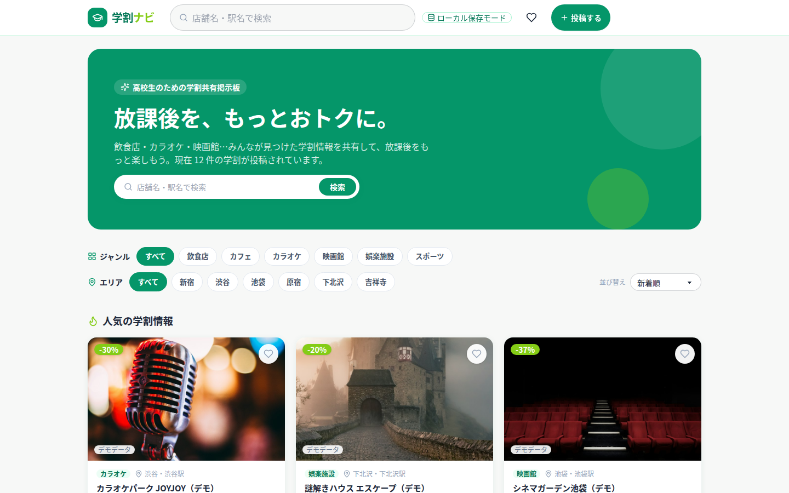
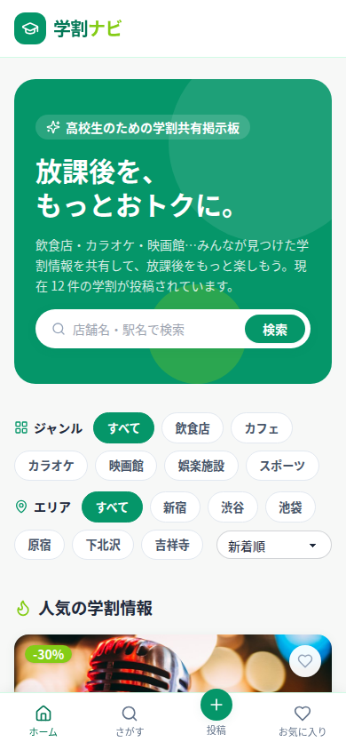

# 学割ナビ

高校生が利用できる学割情報を投稿・共有できる掲示板サイトです。
キャッチコピー：**「放課後を、もっとおトクに。」**

学校の Azure 実習課題として、静的サイト版と Flask + Azure Storage 版の2構成を実装しています。




## 構成

| フォルダ / ファイル | 内容 |
|---|---|
| `app.py` | Flask アプリ本体（ルーティング、バリデーション、CSRF・連投制限） |
| `storage.py` | 保存層。Azure Table/Blob とローカル保存を環境変数で切替 |
| `sample_data.py` | サンプルデータ12件（すべて架空のデモデータ） |
| `templates/` `static/` | Jinja2 テンプレート、CSS/JS、自作のデモ画像 |
| `static_site/` | 静的サイト版（`tools/build_static_site.py` で生成）。Flask版と同じ App Service の `/static-demo/` でも公開される |
| `.github/workflows/` | GitHub Actions（push で App Service へ自動デプロイ） |
| `docs/azure-deploy.md` | Azure の設定・デプロイ手順書 |
| `FEATURES.md` | 実装済み機能と未実装機能の一覧 |
| `requirements.md` | 要件定義書 |

## フロントエンドのCSSについて

Tailwind CSS と daisyUI は、CDNではなく **ビルド済みのCSS**（`static/css/app.css`）を同梱しています。
テンプレートを変更してクラスを追加した場合は、再ビルドしてください。

```bash
cd tools/frontend
npm install
npm run build
```

Lucide Icons も `static/js/lucide.min.js` として同梱しています（フォントのみ Google Fonts を利用）。

## ローカルでの動かし方

```bash
python -m venv .venv
.venv\Scripts\activate        # Windows の場合（Mac/Linux は source .venv/bin/activate）
pip install -r requirements.txt
python app.py
```

ブラウザで http://localhost:5000 を開いてください。
Azure の環境変数を設定していない場合は **ローカル保存モード** で動き、
データは `instance/local_data/` に保存されます（画面右上にモードが表示されます）。

静的サイト版は http://localhost:5000/static-demo/ で確認できます
（Flask版と静的版を、同じ App Service から公開する構成です）。

保存先への実接続の確認は http://localhost:5000/health で行えます。
Azure モードで接続に失敗している場合は `status: error`（HTTP 503）になり、正常とは表示されません。

## Azure への公開手順（概要）

詳しくは [docs/azure-deploy.md](docs/azure-deploy.md) を参照してください。流れは次のとおりです。

1. リソースグループ `rg-gakuwari` を作成（Japan East）
2. ストレージアカウントを作成（Table / Blob 用）
3. App Service（Python 3.12 / Linux）を作成
4. スタートアップコマンドに `gunicorn --bind=0.0.0.0 --timeout 600 app:app` を設定
5. 環境変数に `SECRET_KEY` と `AZURE_STORAGE_CONNECTION_STRING`（またはマネージドID方式）を設定
6. GitHub リポジトリと連携し、`main` への push で自動デプロイ
7. `https://<アプリ名>.azurewebsites.net/health` で `storage: azure` を確認

## セキュリティについて

- 接続文字列・アクセスキー・SAS・発行プロファイル・`.env` は **絶対にコミットしません**（`.gitignore` 済み）
- 画像コンテナーは非公開とし、Flask 経由でのみ配信します
- 画像の読み取りにはパストラバーサル対策（UUID形式のファイル名と許可拡張子のみ許可、保存ディレクトリ外は読まない）を実装しています
- XSS対策（Jinja2の自動エスケープ）、CSRF対策（トークン）、入力値検証、
  画像の形式・サイズ制限（5MB）に加え、Pillow で画像の実体（実フォーマット・ピクセル数）を検証します
- 投稿の連投制限（30秒）、いいね・通報の連打対策（同一セッションでは同じ投稿に1回まで＋短時間の連続操作制限）、通報機能を実装しています
- GitHub Actions のワークフローは Azure の自動生成と重複しないよう専用名にしています（使うのは1つだけ。詳細は `docs/azure-deploy.md`）
- 本名・学校名・学生証などの個人情報は投稿しないよう、画面上に注意書きを表示しています

## 注意

- サンプルデータの店舗・価格はすべて架空のデモデータです（画面上にも明記しています）
- 静的版の投稿・コメントはブラウザの LocalStorage に保存され、サーバーには保存されません
